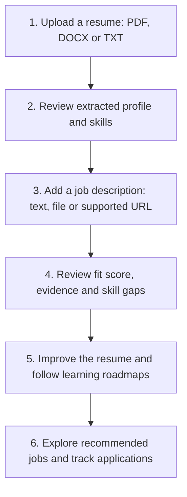

# SkillBit — Presentation Context

**Source:** [README.md](README.md)  
**Format:** Exactly 10 slides · approximately 6–8 minutes  
**Audience:** Project reviewers, students, and placement teams

## Presentation Guidelines

- Use the slide order below. Keep speaker notes off the slides.
- Use large text, short bullets, and one main visual per slide.
- Prefer the supplied logo, workflow, and simple cards over dense diagrams.
- Do not add unsupported rejection statistics, accuracy claims, or before/after charts.
- Explain ATS once as **Applicant Tracking System**, the software used to process job applications.

---

## Slide 1 — Title Page

### On-slide Content

**SkillBit**  
**AI Resume Builder, Job Finder & Skill Gap Analyzer**

*Understand your fit. Improve your resume. Plan your next step.*

A career-support platform for job seekers and university placement teams.

### Visual

Use the project logo beside the title:

### Speaker Note

“SkillBit brings resume preparation, job matching, and guided learning together in one platform.”

---

## Slide 2 — Problem Statement

### On-slide Content

- Candidates struggle to understand how their resume matches a job.
- Simple keyword checks can miss equivalent skills and practical experience.
- Missing-skill feedback often lacks a clear learning plan.
- Resume editing, job searching, and application tracking are spread across tools.

### Visual

Use four small cards: **Unclear Fit · Missed Evidence · No Learning Plan · Scattered Tools**.

### Speaker Note

“The challenge is not just writing a resume—it is knowing what to improve and which opportunities to pursue.”

---

## Slide 3 — Proposed Solution

### On-slide Content

**One platform: assess, improve, and explore.**

- **Understand:** Extract skills and experience from a resume.
- **Explain:** Show job-fit scores, matching evidence, and skill gaps.
- **Improve:** Offer learning roadmaps, editable AI suggestions, and ATS-friendly PDFs.
- **Explore:** Recommend relevant jobs and track saved or applied opportunities.

### Visual

Use four connected cards: **Understand → Explain → Improve → Explore**.

### Speaker Note

“Rule-based scoring explains the match, while AI helps with writing and learning suggestions that the user can review.”

---

## Slide 4 — Tech Stack

### On-slide Content

| Layer | Main Technologies | Purpose |
| :--- | :--- | :--- |
| User interface | React, TypeScript, Tailwind CSS, Vite | Interactive web application |
| Backend | Python, FastAPI | APIs and application logic |
| Skill matching | Scikit-learn, rule-based NLP | Extract skills and compare job requirements |
| Data storage | SQLAlchemy, SQLite / PostgreSQL | Store profiles, resumes, and results |
| Documents | PyMuPDF, python-docx, ReportLab | Read resumes and generate PDFs |
| AI assistance | Groq, Gemini, Grok, OpenAI; local fallback | Writing suggestions and learning content |

### Visual

Use this table as the main visual; avoid adding version numbers or extra library lists.

### Speaker Note

“The frontend handles interaction, FastAPI runs the workflow, and the matching engine combines skill rules with text similarity.”

---

## Slide 5 — Overview

### On-slide Content

**How a candidate uses SkillBit**

### Visual — Main Workflow

**Supporting features:** Email verification, Google sign-in, profile settings, and placement analytics.

### Speaker Note

“Users can compare a specific job or explore personalized recommendations. Job applications are submitted on employer websites; SkillBit records their status.”

---

## Slide 6 — Key Features

### On-slide Content

- **Smarter resume editing:** Import public GitHub projects, improve accomplishment bullets, and auto-format messy text.
- **Flexible job input:** Paste a job description, upload a file, or import a supported public URL.
- **Personalized job discovery:** Filter opportunities and compare which saved resume fits best.
- **Account tools:** Verify email by code or link, use Google sign-in, and manage profile pictures.

### Visual

Use a 2 × 2 feature grid: **Resume Tools · Job Import · Job Finder · Account Settings**.

### Speaker Note

“These features reduce manual work across the workflow. Public URL imports depend on page access and supported job data; users can paste text or upload a file instead.”

---

## Slide 7 — Explainable Matching & User Control

### On-slide Content

- **Recognize equivalent skills:** Match names such as “Postgres” and “PostgreSQL.”
- **Check practical evidence:** Distinguish skills listed on a resume from skills demonstrated in projects or experience.
- **Explain each result:** Show strong matches, partial matches, weak evidence, and missing skills.
- **Keep users in control:** Review AI suggestions before using them; discovery explanations respect the external-AI consent setting.

### Visual

Use this simple explanation strip:

**Skill name → Resume evidence → Match explanation → Learning action**

### Speaker Note

“SkillBit explains the evidence behind a result rather than giving only a score. AI suggestions still need review, and discovery consent is not a global opt-out for every AI feature.”

---

## Slide 8 — Benefits

### On-slide Content

- **Clearer decisions:** See why a skill matches or needs stronger evidence.
- **Focused preparation:** Turn gaps into step-by-step learning tasks.
- **Easier resume preparation:** Edit suggestions and export a clean PDF.
- **Better organization:** Keep job recommendations and application records together.
- **Placement insights:** Help universities identify common student skill gaps.

### Visual

Use two columns: **For Candidates** (first four benefits) and **For Placement Teams** (last benefit).

### Speaker Note

“The main benefit is actionable guidance—not just a percentage. Scores do not guarantee interviews or employment, and job availability can change.”

---

## Slide 9 — Goals

### On-slide Content

**Project goals—not measured outcome claims**

- Make resume-to-job matching understandable and explainable.
- Help candidates present genuine skills and experience clearly.
- Connect skill gaps with practical learning and project work.
- Bring resume improvement, job discovery, and tracking into one workflow.

### Visual

Use a four-step goal ladder: **Clarity → Authenticity → Learning → Readiness**.

### Speaker Note

“Our goal is to support informed preparation and career readiness while keeping users in control of their information and AI suggestions.”

---

## Slide 10 — References

### On-slide Content

- **Project documentation:** [SkillBit README](README.md)
- **Source code:** [SkillBit GitHub Repository](https://github.com/tanishikpremi/SkillBit-AI-Resume-Builder-Skill-Gap-Analyzer)
- **Frontend:** [React Documentation](https://react.dev/)
- **Backend:** [FastAPI Documentation](https://fastapi.tiangolo.com/)
- **Text similarity:** [Scikit-learn — Text Feature Extraction](https://scikit-learn.org/stable/modules/feature_extraction.html#text-feature-extraction)
- **Structured job data:** [Schema.org — JobPosting](https://schema.org/JobPosting)

**Thank you — Questions?**

### Visual

Use a clean references list and a small project logo. Keep links clickable in the exported presentation.

### Speaker Note

“The project README is the source for the features presented; the remaining references document the technologies and job-data standard used.”
