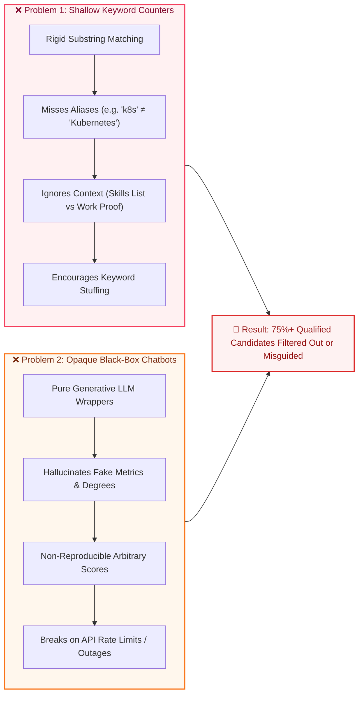
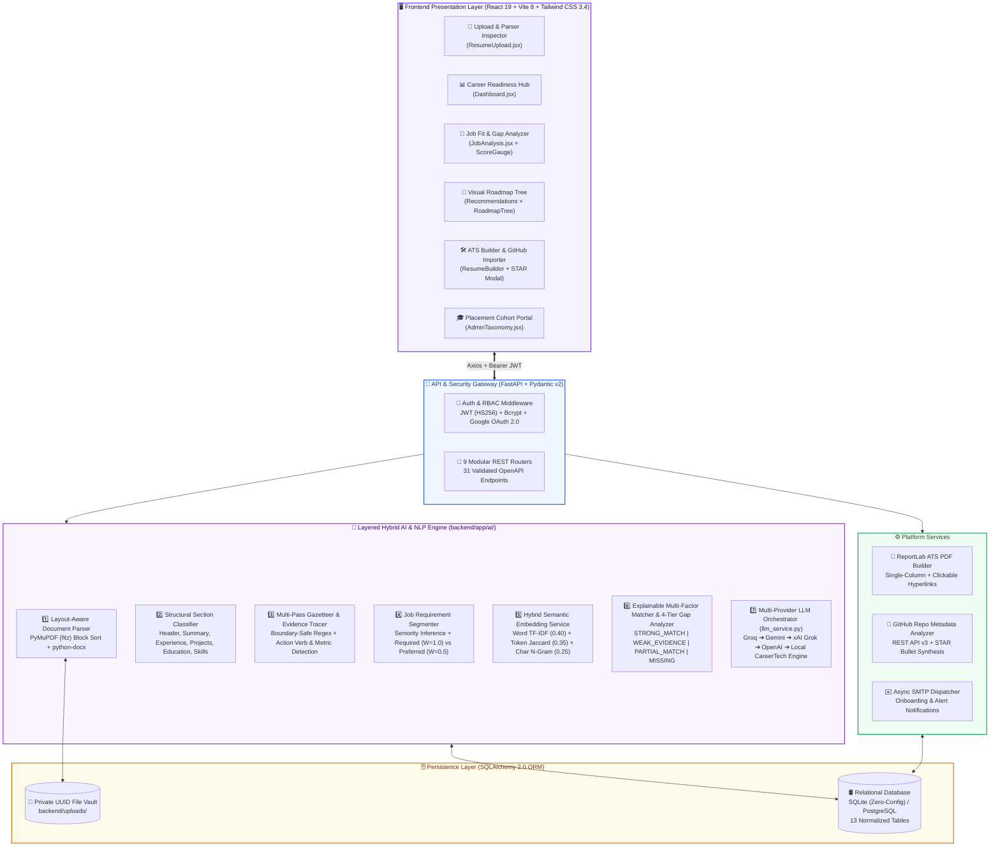
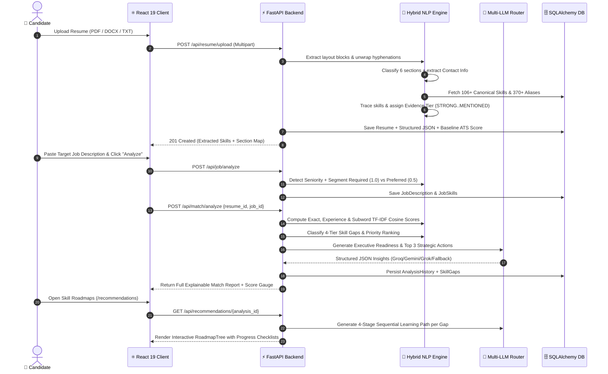
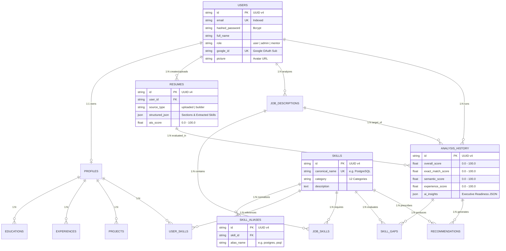
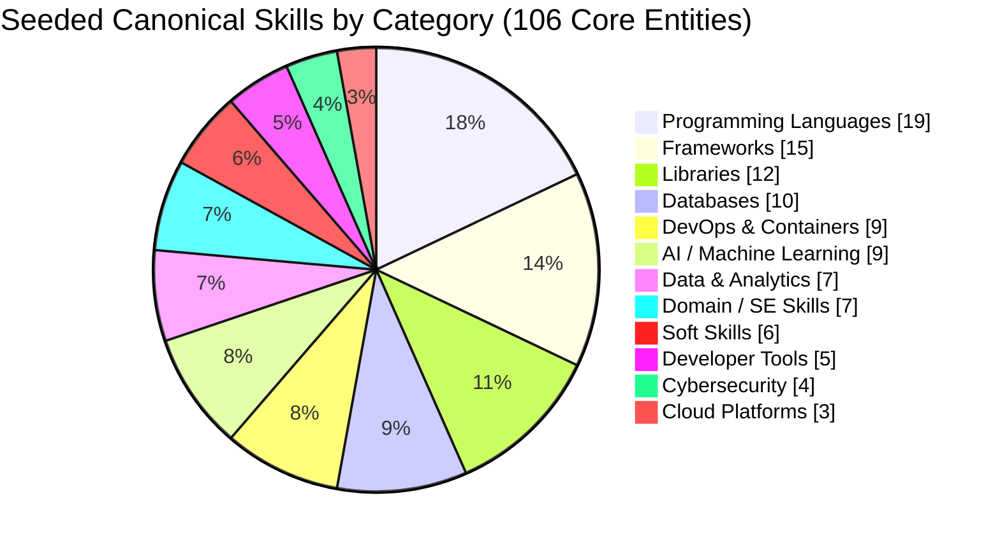
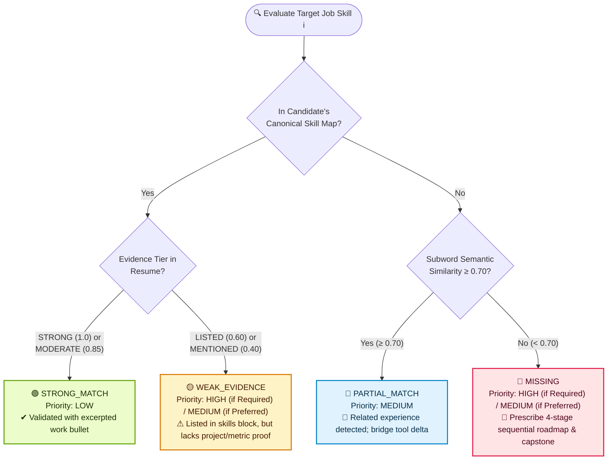
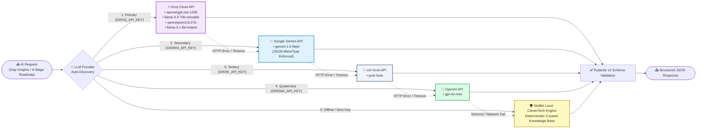

<div align="center">


# ⚡ SkillBit
### **Explainable AI Resume Builder, ATS Job Matcher & Visual Skill Gap Engine**

*Bridging candidate resumes and modern Applicant Tracking Systems (ATS) through deterministic NLP heuristics, canonical skill normalization, hybrid subword semantic matching, multi-provider LLM failover orchestration, and interactive `roadmap.sh`-style learning trees.*

<br/>

<!-- CORE TECH STACK & STATUS BADGES -->
[](https://www.python.org/)
[](https://fastapi.tiangolo.com/)
[](https://react.dev/)
[](https://vitejs.dev/)
[](https://tailwindcss.com/)
[](https://www.sqlalchemy.org/)
[](https://scikit-learn.org/)

<!-- AI & QUALITY LABELS -->
[](#6-multi-provider-llm-failover-architecture)
[](#-chart-1-canonical-skill-taxonomy-distribution)
[-0284C7?style=flat-square&logo=swagger&logoColor=white)](#10-complete-rest-api-reference)
[-4F46E5?style=flat-square&logo=postgresql&logoColor=white)](#5-system-architecture--database-design)
[](#12-testing--quality-assurance)
[](#8-tech-stack--libraries)
[](LICENSE)

<br/>

[📖 Concept & Vision](#1-project-description--core-concept) •
[⚠️ Problem](#2-the-problem-landscape) •
[💡 Solution](#3-the-skillbit-solution) •
[🏗️ Architecture](#4-layered-system-architecture) •
[📐 Mathematical Engine](#5-mathematical-formulation--analytics-charts) •
[🤖 Multi-LLM Router](#6-multi-provider-llm-failover-architecture) •
[✨ Functionality](#7-core-functionality--feature-tour) •
[🧰 Tech Stack](#8-tech-stack--libraries) •
[🔌 API Docs](#10-complete-rest-api-reference) •
[🚀 Quickstart](#11-installation--quickstart)

</div>

---

## 📌 Executive At-a-Glance Metrics

| 🏛️ Architectural Pillar | 📊 Key Metric / Specification | 🔍 Verification & Implementation |
| :--- | :--- | :--- |
| **Canonical Skill Taxonomy** | **106+** Seeded Core Skills • **370+** Aliases • **12** Categories | Extensible to 500+ via `/api/admin/skills` (`taxonomy_data.py`) |
| **Explainable Fit Scoring** | **4** Sub-Indices (`Overall`, `Exact`, `Experience`, `Semantic`) | Deterministic $O(N \cdot M)$ mathematical formula (`matching_engine.py`) |
| **Evidence Verification Tiers** | **4** Tiers (`STRONG: 1.0`, `MODERATE: 0.85`, `LISTED: 0.60`, `MENTIONED: 0.40`) | Section-aware action-verb & metric detection (`skill_extractor.py`) |
| **Skill Gap Classification** | **4** States (`STRONG_MATCH`, `WEAK_EVIDENCE`, `PARTIAL_MATCH`, `MISSING`) | Priority-ranked (`HIGH`, `MEDIUM`, `LOW`) with snippet proof (`gap_analyzer.py`) |
| **Multi-LLM Failover Engine** | **5** Providers (`Groq` → `Gemini` → `Grok` → `OpenAI` → `Local Engine`) | Zero-downtime JSON-validated orchestration (`llm_service.py`) |
| **REST API & Data Layer** | **31** Endpoints across **9** Routers • **13** SQLAlchemy 2.0 Tables | Auto-migrating SQLite / PostgreSQL engine (`main.py`, `models/`) |
| **Automated Test Coverage** | **10** Test Suites • **32+** Unit & E2E Integration Tests | 100% pass rate with isolated in-memory DB fixtures (`backend/tests/`) |

---

## 1. Project Description & Core Concept

**SkillBit** is a production-grade **AI Resume Builder, Explainable ATS Matcher, and Career Intelligence Platform** engineered for job seekers, software engineers, and university placement cohorts.

### 🧠 The Core Concept: *Explainable Hybrid Career Intelligence*
Modern recruitment pipelines rely heavily on **Applicant Tracking Systems (ATS)** to parse, filter, and rank candidates before a human recruiter ever reads a resume. However, candidates face a black-box ecosystem where they neither know *why* their resume was rejected nor *how* to bridge their technical skill gaps effectively.

**SkillBit** introduces a **Layered Hybrid AI Paradigm** that separates deterministic truth from generative creativity:
1. **Deterministic Rules & Canonical Taxonomy Layer**: Guarantees 100% reproducible skill normalization (e.g., mapping `React.js`, `reactjs`, and `React JS` to canonical `React`, while keeping `Java` strictly separate from `JavaScript`), role authorization, and zero-hallucination guardrails.
2. **Contextual NLP & Subword Semantic Layer**: Parses multi-column/single-column PDFs and DOCX files, classifies structural resume sections, traces whether a skill is backed by **action verbs and quantified metrics** in work experience vs. merely listed in a footer, and computes hybrid **Word TF-IDF + Token Overlap + Character N-Gram Cosine Similarity**.
3. **Resilient Multi-Provider LLM Layer**: Orchestrates **Groq (Llama 3.3 / GPT-OSS-120B)**, **Google Gemini 1.5 Flash**, **xAI Grok**, and **OpenAI GPT-4o-mini** with an automatic offline fallback engine to synthesize executive career assessments, rewrite weak bullets using the **STAR (Situation-Task-Action-Result)** framework, analyze public **GitHub repositories**, and generate 4-stage sequential learning roadmaps.
4. **Interactive Visual & Document Generation Layer**: Renders `roadmap.sh`-inspired interactive learning trees with persistent progress tracking and compiles single-column, machine-readable **ATS PDF resumes** via ReportLab with embedded clickable hyperlinks.

---

## 2. The Problem Landscape

Commercial resume tools and ATS scanners currently fall into two flawed extremes:



### Key Pain Points Addressed
* **Alias Blindness & Boundary Collisions**: Standard regex counters fail to equate `Postgres` with `PostgreSQL` or `Node` with `Node.js`, or worse, falsely match `Java` inside `JavaScript` or `C` inside `CSS`.
* **Evidence Blindness**: Listing `"Docker, Kubernetes, AWS"` in a skills section is treated identically to *"Architected multi-stage Docker containers and scaled Kubernetes clusters on AWS handling 50k req/min"* by basic scanners—whereas real engineering managers and modern ATS parsers weight contextual experience heavily.
* **Hallucination Risk in Generative Resume Builders**: Pure LLM resume rewriters frequently invent unverified technologies, fake percentages, or companies the candidate never worked at, creating severe ethical and interview-failure risks.
* **Lack of Actionable Upskilling Paths**: Telling a candidate *"You are missing Kubernetes and Apache Kafka"* is unhelpful without a structured, chronological roadmap of sub-topics, documentation links, and portfolio capstone projects to prove competence.
* **Zero Visibility for University Placement Teams**: University career centers lack cohort-wide telemetry showing which specific industry skills their graduating students are missing most frequently.

---

## 3. The SkillBit Solution

SkillBit solves each problem through a transparent, verifiable, human-in-the-loop workflow:

| ⚠️ Industry Problem | 🛡️ SkillBit Engineering Solution | 📂 Core Module |
| :--- | :--- | :--- |
| **Synonym & Alias Mismatch** | **3-Tier Canonical Skill Normalizer** with boundary-safe regex (`(?<![a-zA-Z0-9+#])`) resolving 370+ aliases across 12 categories. | `skill_normalizer.py`<br>`taxonomy_data.py` |
| **No Distinction Between "Listed" & "Proven" Skills** | **4-Tier Evidence Tracer** scanning classified sections (`Experience`, `Projects`, `Skills`, `Summary`) for 19+ high-impact action verbs & numeric metrics. | `skill_extractor.py`<br>`section_classifier.py` |
| **Unexplained "Black-Box" Match Percentages** | **Deterministic Multi-Factor Fit Formula** breaking scores into `Overall`, `Exact Match`, `Experience Evidence`, and `Semantic Resonance`. | `matching_engine.py`<br>`embedding_service.py` |
| **Vague Gap Feedback** | **4-Tier Gap Classifier** (`STRONG_MATCH`, `WEAK_EVIDENCE`, `PARTIAL_MATCH`, `MISSING`) sorted by `REQUIRED (W=1.0)` vs `PREFERRED (W=0.5)` priority. | `gap_analyzer.py`<br>`job_analyzer.py` |
| **LLM Hallucinations & API Downtime** | **Anti-Hallucination STAR Optimizer** with Human-in-the-Loop (`Accept`/`Edit`/`Reject`) + **5-Tier LLM Provider Failover** (`Groq` → `Gemini` → `Grok` → `OpenAI` → `Local`). | `resume_content_generator.py`<br>`llm_service.py` |
| **Unstructured Learning Advice** | **Interactive 4-Stage Visual Roadmap Tree (`RoadmapTree.jsx`)** with sequential topic checklists, `localStorage` progress bars, milestones, and official docs. | `recommendation_engine.py`<br>`RoadmapTree.jsx` |
| **Non-Compliant Multi-Column PDFs** | **Server-Side ReportLab ATS PDF Engine** generating clean, single-column machine-parsable PDFs with clickable `LinkedIn`/`GitHub` links & live GitHub Repo ingestion. | `pdf_service.py`<br>`api/resume.py` |

---

## 4. Layered System Architecture

### 4.1 High-Level System Architecture Diagram



---

### 4.2 End-to-End Execution Sequence Diagram



---

### 4.3 Relational Database Schema (13 Models)



---

## 5. Mathematical Formulation & Analytics Charts

### 5.1 Deterministic Multi-Factor Fit Formula

Unlike black-box LLM scorers that return different numbers on every run, SkillBit computes the candidate Fit Score $S \in [0.0, 100.0]$ deterministically:

$$S = \min\left(100.0, \ \frac{\sum_{i \in \text{JobSkills}} W_i \cdot \mathcal{F}(i, \text{Profile})}{\sum_{i \in \text{JobSkills}} W_i} \times 100\right)$$

Where:
* **Requirement Importance Weight ($W_i$)**:
  $$W_i = \begin{cases} 1.0 & \text{if skill } i \text{ is in a REQUIRED section} \\ 0.5 & \text{if skill } i \text{ is in a PREFERRED / BONUS section} \end{cases}$$

* **Candidate Skill Alignment Factor ($\mathcal{F}(i)$)**:
  $$\mathcal{F}(i) = \begin{cases} 0.60 \cdot \mathcal{M}_{\text{exact}} + 0.40 \cdot \max\left(\mathcal{E}_{\text{level}}, \ \mathcal{S}_{\text{semantic}}\right) & \text{if canonical skill } i \text{ is matched} \\ 0.45 \cdot \mathcal{S}_{\text{semantic}} & \text{if skill } i \text{ is missing, but } \mathcal{S}_{\text{semantic}} \ge 0.70 \\ 0.0 & \text{otherwise} \end{cases}$$

* **Hybrid Semantic Similarity ($\mathcal{S}_{\text{semantic}} \in [0.0, 1.0]$)**:
  $$\mathcal{S}_{\text{semantic}}(A, B) = 0.40 \cdot \cos_{\text{word-tfidf}}(A, B) + 0.35 \cdot \frac{|T_A \cap T_B|}{|T_A \cup T_B|} + 0.25 \cdot \cos_{\text{char-wb}(3,5)}(A, B)$$

---

### 📊 Chart 1: Canonical Skill Taxonomy Distribution

SkillBit ships with **106 core canonical skills** and **370+ normalized aliases** across **12 industry domains** on initial database seed (and scales dynamically via the Admin Taxonomy API):



```text
Category Breakdown & Alias Coverage:
━━━━━━━━━━━━━━━━━━━━━━━━━━━━━━━━━━━━━━━━━━━━━━━━━━━━━━━━━━━━━━━━━━━━━━━━━━━━━━━━━━━━
Programming Languages │ ███████████████████ 19 skills (17.9%) │ Python, TS, Java, Go, Rust, C++...
Frameworks            │ ███████████████     15 skills (14.2%) │ React, FastAPI, Next.js, Spring...
Libraries             │ ████████████        12 skills (11.3%) │ PyTorch, TensorFlow, Pandas, Redux...
Databases             │ ██████████          10 skills ( 9.4%) │ PostgreSQL, MongoDB, Redis, Elastic...
DevOps & Infra        │ █████████            9 skills ( 8.5%) │ Docker, Kubernetes, Terraform, CI/CD...
AI / Machine Learning │ █████████            9 skills ( 8.5%) │ LLMs, RAG, NLP, Computer Vision...
Data & Analytics      │ ███████              7 skills ( 6.6%) │ Spark, Kafka, Snowflake, ETL, Tableau...
Domain / Architecture │ ███████              7 skills ( 6.6%) │ Microservices, System Design, REST, TDD...
Soft Skills           │ ██████               6 skills ( 5.7%) │ Leadership, Problem Solving, Agile...
Developer Tools       │ █████                5 skills ( 4.7%) │ Git, GitHub, Postman, Jira, Figma
Cybersecurity         │ ████                 4 skills ( 3.8%) │ OWASP, Pentesting, Cryptography...
Cloud Platforms       │ ███                  3 skills ( 2.8%) │ AWS, Microsoft Azure, Google Cloud (GCP)
━━━━━━━━━━━━━━━━━━━━━━━━━━━━━━━━━━━━━━━━━━━━━━━━━━━━━━━━━━━━━━━━━━━━━━━━━━━━━━━━━━━━
```

---

### 📈 Chart 2: Evidence Tier Multipliers & Hybrid Scoring Weights

When SkillBit extracts a skill from a candidate's resume, it does not treat all mentions equally. It inspects the **structural section** and checks for **action verbs** (`architected`, `engineered`, `deployed`, `optimized`, `scaled`, etc.):

```text
EVIDENCE TIER MULTIPLIERS (E_level)
┌──────────────────────────────────────────────────────────────────────────────────┐
│ 🏆 STRONG    (1.00x) │ ████████████████████████████████████████ │ 100% Weight    │
│                      │ Found in Experience/Projects + Action Verb (e.g. "Built") │
├──────────────────────────────────────────────────────────────────────────────────┤
│ 🥈 MODERATE  (0.85x) │ ██████████████████████████████████░░░░░░ │  85% Weight    │
│                      │ Found in Experience/Projects without strong action verb   │
├──────────────────────────────────────────────────────────────────────────────────┤
│ 📋 LISTED    (0.60x) │ ████████████████████████░░░░░░░░░░░░░░░░ │  60% Weight    │
│                      │ Listed only in raw Technical Skills block (unproven)      │
├──────────────────────────────────────────────────────────────────────────────────┤
│ 💬 MENTIONED (0.40x) │ ████████████████░░░░░░░░░░░░░░░░░░░░░░░░ │  40% Weight    │
│                      │ Mentioned casually in Summary or Header only              │
└──────────────────────────────────────────────────────────────────────────────────┘

HYBRID SEMANTIC SIMILARITY COMPOSITION (S_semantic)
┌───────────────────────────┬──────────────────────────┬───────────────────────────┐
│  40% Word N-Gram TF-IDF   │  35% Token Jaccard Set   │ 25% Char N-Gram (3..5 wb) │
│   (1-2 word phrases)      │  (Stop-word filtered)    │ (Morphological subwords)  │
└───────────────────────────┴──────────────────────────┴───────────────────────────┘
```

---

### 🎯 Chart 3: 4-Tier Skill Gap Classification & Priority Matrix



| Gap Status Badge | Detection Condition | Importance = `REQUIRED` ($W=1.0$) | Importance = `PREFERRED` ($W=0.5$) | Prescribed Action by Engine |
| :--- | :--- | :---: | :---: | :--- |
| 🟢 **`STRONG_MATCH`** | Skill present + `STRONG` or `MODERATE` evidence in Experience/Projects | `LOW` Priority | `LOW` Priority | Preserves matched bullet snippet as verified proof; no remediation needed. |
| 🟡 **`WEAK_EVIDENCE`** | Skill present only in `Skills` list (`LISTED`) or `Summary` (`MENTIONED`) | `HIGH` Priority | `MEDIUM` Priority | Prompts candidate to rewrite experience bullets with **STAR Optimizer** & metrics. |
| 🔵 **`PARTIAL_MATCH`** | Exact skill absent, but bullet semantic cosine similarity $\ge 0.70$ | `MEDIUM` Priority | `MEDIUM` Priority | Highlights transferable domain context and prescribes targeted syntax delta. |
| 🔴 **`MISSING`** | Absent from profile & semantic similarity $< 0.70$ | `HIGH` Priority | `MEDIUM` Priority | Generates **4-Stage Sequential Learning Roadmap**, docs link, and capstone project. |

---

## 6. Multi-Provider LLM Failover Architecture

To guarantee **100% uptime, zero cost during academic evaluations, and resilience against API rate-limits**, `llm_service.py` implements an intelligent 5-tier cascading provider router:



### 🛡️ Responsible AI & Anti-Hallucination Guardrails
1. **Zero Credential Fabrication**: The STAR bullet improver (`resume_content_generator.py`) is strictly constrained to strengthen passive phrasing (e.g., `"worked on"` $\rightarrow$ `"engineered"`, `"helped with"` $\rightarrow$ `"facilitated"`, `"used"` $\rightarrow$ `"leveraged"`) and surface metric placeholders—it **never** invents fake companies, degrees, or unverified certifications.
2. **Human-in-the-Loop Authority (`BulletSuggestionModal.jsx`)**: Candidates explicitly **Accept**, **Edit**, or **Reject** every AI-generated bullet suggestion before it touches their resume.
3. **Transparent Legal & Ethical Disclaimer**: Every match evaluation embeds the explicit notice:
   > *"This score is an automated ATS alignment indicator and does not guarantee employment or interview selection."*

---

## 7. Core Functionality & Feature Tour

### 1️⃣ Layout-Aware Resume Ingestion (`/upload`)
* **Multi-Format Support**: Accepts `.pdf`, `.docx`, and `.txt` files up to 5 MB (`file_storage.py` stores files in a private UUID-named vault).
* **Layout Block Sorting**: Uses **PyMuPDF (`fitz`)** coordinate block sorting (`page.get_text("blocks", sort=True)`) to preserve reading order, normalize Unicode bullets, and unwrap hyphenated line-breaks (`"imple-\nmentation"` $\rightarrow$ `"implementation"`).
* **Real-Time Extraction Inspector**: Displays baseline ATS Readability Score, detected structural sections (`Contact`, `Summary`, `Experience`, `Projects`, `Education`, `Skills`), and extracted canonical skills with their evidence badges (`STRONG`, `MODERATE`, `LISTED`).

### 2️⃣ AI Career Readiness Hub (`/dashboard`)
* **Composite Quality KPIs**: Computes **Profile Completeness %**, **Quantified Achievements Score** (percentage of experience bullets containing measurable numbers/metrics), **ATS Formatting Score**, and **Overall Quality Composite**.
* **One-Click Master Profile Sync**: Synchronizes parsed resume sections, work history, projects, and verified skills into the persistent user profile (`POST /api/profile/sync-from-resume`).
* **Skill Category Distribution & Critical Gaps**: Visualizes the candidate's skill portfolio across categories and highlights top high-priority gaps from recent evaluations.

### 3️⃣ Explainable Job Fit & Skill Gap Analyzer (`/match`)
* **Intelligent JD Segmentation**: Automatically detects role seniority (`Lead`, `Senior`, `Mid`, `Entry`) and splits Job Descriptions into **Required Qualifications** ($W=1.0$) vs. **Preferred / Bonus Skills** ($W=0.5$).
* **SVG Radial Score Gauge (`ScoreGauge.jsx`)**: Visualizes Overall Fit Score alongside granular bars for **Exact Match**, **Semantic Context**, and **Experience Evidence**.
* **Executive AI Insights Banner**: Displays readiness tier (`Interview Ready`, `Near Match (Minor Gaps)`, or `Core Upskilling Required`), a 2–3 sentence executive synthesis, **Top Improvement Priorities**, and an **Immediate Strategic Action Plan** with on-demand LLM regeneration.
* **Filterable Gap Drilldown Cards (`GapCard.jsx`)**: Filter by `ALL`, `MISSING`, `WEAK_EVIDENCE`, or `STRONG_MATCH`. Each card shows side-by-side **Resume Evidence** vs. **Job Requirement Context** and a direct link to launch the skill's learning roadmap.

### 4️⃣ Interactive `roadmap.sh`-Style Learning Trees (`/recommendations`)
* **4-Stage Sequential Progression (`RoadmapTree.jsx`)**: Breaks every missing or weak skill into 4 chronological stages:
  1. *Stage 01: Foundations & Modern Syntax* (3–5 days)
  2. *Stage 02: Core Architecture & Patterns* (5–7 days)
  3. *Stage 03: Production Engineering & Quality* (5–7 days)
  4. *Stage 04: Capstone Portfolio Proof* (4–6 days)
* **Interactive Topic Checklists**: Candidates click individual sub-topics (`1.1`, `1.2`, etc.) to mark them mastered; progress percentage is persisted in `localStorage`.
* **Custom On-Demand AI Roadmap Generator**: Candidates can generate a custom 4-stage roadmap for *any* arbitrary technology and target role via `POST /api/recommendations/generate-roadmap`.

### 5️⃣ ATS Resume Builder, GitHub Repo Analyzer & PDF Exporter (`/builder`)
* **Live Split-Screen Editor & Preview**: Edit contact coordinates, summary, technical skills, work experiences, projects, and education with an instant single-column ATS preview.
* **GitHub Repository AI Importer (`POST /api/resume/analyze-repo`)**: Paste any public GitHub repository URL (e.g., `https://github.com/owner/repo`) to automatically fetch repository metadata, stars, primary language, and topics via the GitHub REST API and synthesize 3 high-impact **STAR accomplishment bullets**.
* **Interactive STAR Bullet Optimizer (`BulletSuggestionModal.jsx`)**: Click **"AI Improve (STAR)"** on any experience or project bullet to transform passive statements into quantified, action-driven accomplishments.
* **Server-Side ReportLab PDF Export (`GET /api/resume/{id}/export`)**: Streams a binary, machine-readable single-column PDF with `Helvetica` typography, clean horizontal rules, and clickable blue underlined hyperlinks (`LinkedIn`, `GitHub`, `Live Demo`).

### 6️⃣ University Placement & Admin Cohort Portal (`/admin`)
* **Role-Based Access Control (`adminOnly`)**: Restricted to placement officers and administrators (`admin@skillbit.ai`).
* **Cohort Readiness Telemetry**: Aggregates total candidates, total resumes built/uploaded, total job evaluations run, cohort-wide average ATS match index, and the **Top 10 Most Frequent Missing Skills** across the student batch to guide curriculum bootcamps.
* **Canonical Taxonomy CRUD**: Add new canonical skills, descriptions, and comma-separated aliases directly into the database.

---

## 8. Tech Stack & Libraries

### 🖥️ Frontend Stack (`/frontend`)
| Technology | Badge | Version | Role in SkillBit |
| :--- | :--- | :---: | :--- |
| **React** |  | `^19.2.8` | Component-driven SPA architecture, hooks, and context state |
| **Vite** |  | `^8.3.0` | Lightning-fast HMR dev server and optimized ES module bundler |
| **Tailwind CSS** |  | `^3.4.17` | Glassmorphic SaaS design system (`#F5F2FC` canvas, `#11121F` sidebar) |
| **React Router** |  | `^7.18.4` | Client-side routing, URL query state, and `ProtectedRoute` RBAC guards |
| **Lucide React** |  | `^1.52.0` | Crisp, consistent vector iconography across all views |
| **Axios** |  | `^1.20.0` | HTTP client with automatic JWT Bearer token request/response interceptors |

### ⚙️ Backend, AI/NLP & Data Stack (`/backend`)
| Technology | Badge | Version | Role in SkillBit |
| :--- | :--- | :---: | :--- |
| **Python** |  | `3.12 / 3.14` | Core backend runtime and scientific computing environment |
| **FastAPI** |  | `>=0.110.0` | High-performance async REST framework with automatic OpenAPI/Swagger docs |
| **Pydantic v2** |  | `>=2.6.0` | Strict request/response schema validation and `.env` settings management |
| **SQLAlchemy 2.0** |  | `>=2.0.28` | Relational ORM managing 13 interconnected tables & auto-migrations |
| **Scikit-Learn** |  | `>=1.4.0` | `TfidfVectorizer` (word & `char_wb` n-grams) + `cosine_similarity` engine |
| **PyMuPDF (`fitz`)** |  | `>=1.23.0` | Coordinate-sorted PDF block extraction and artifact cleaning |
| **python-docx** |  | `>=1.1.0` | Paragraph and table extraction from Microsoft Word `.docx` resumes |
| **ReportLab** |  | `>=4.1.0` | Server-side single-column ATS PDF generation with clickable links |
| **PyJWT / Jose & Bcrypt** |  | `>=3.3.0` | Stateless HMAC-SHA256 JWT tokens & salted Bcrypt password hashing |
| **HTTPX** |  | `>=0.27.0` | REST client for Groq, Gemini, xAI Grok, Google OAuth, and GitHub API |
| **Pytest** |  | `>=8.0.0` | Automated unit & integration testing suite with `TestClient` |

---

## 9. Repository Structure

```text
Skillbit/
├── 📄 README.md                          # Comprehensive project documentation & visual analytics
├── 📄 ARCHITECTURE.md                    # System architecture & academic viva defense reference
├── 📄 PRESENTATION_PPT_GUIDE.md          # Complete 10-slide PPT blueprint, speaker notes & chart data
├── 🚀 start.bat                          # One-click Windows launcher (FastAPI :8000 + Vite :5173)
│
├── 📂 backend/                           # Python FastAPI Backend & Hybrid AI Engine
│   ├── 📋 requirements.txt               # Python package dependencies
│   ├── ⚙️ pytest.ini                     # Pytest configuration
│   ├── 📂 app/
│   │   ├── 🚀 main.py                    # FastAPI app entrypoint, CORS & lifespan DB init
│   │   ├── 🔧 config.py                  # Pydantic BaseSettings & environment variables
│   │   ├── 📂 ai/                        # 🧠 Core Hybrid AI & NLP Pipeline
│   │   │   ├── llm_service.py            # Multi-provider LLM router (Groq/Gemini/Grok/OpenAI/Local)
│   │   │   ├── resume_parser.py          # PyMuPDF block-sorted PDF, DOCX & TXT parser
│   │   │   ├── section_classifier.py     # Structural resume section & contact classifier
│   │   │   ├── skill_extractor.py        # Multi-pass gazetteer & 4-tier evidence tracer
│   │   │   ├── skill_normalizer.py       # Canonical skill & alias resolution
│   │   │   ├── job_analyzer.py           # Seniority detector & Required vs Preferred segmenter
│   │   │   ├── embedding_service.py      # Hybrid Word TF-IDF + Token + Char N-Gram similarity
│   │   │   ├── matching_engine.py        # Deterministic multi-factor fit scoring engine
│   │   │   ├── gap_analyzer.py           # 4-tier gap classification & priority matrix
│   │   │   ├── recommendation_engine.py  # Curated learning catalog & roadmap synthesizer
│   │   │   └── resume_content_generator.py # Anti-hallucination STAR bullet optimizer
│   │   ├── 📂 api/                       # 📡 REST API Routers (31 Endpoints)
│   │   │   ├── auth.py                   # Register, Login, Google OAuth 2.0, SMTP test
│   │   │   ├── profile.py                # Master profile CRUD & one-click resume sync
│   │   │   ├── skills.py                 # Taxonomy search, category list & normalization
│   │   │   ├── resume.py                 # Upload, Builder CRUD, PDF Export, GitHub Repo Analyzer
│   │   │   ├── job.py                    # Job description NLP analysis & CRUD
│   │   │   ├── match.py                  # Hybrid matching, gap reports & AI insights refresh
│   │   │   ├── recommendation.py         # Gap roadmaps, custom AI roadmaps & STAR bullets
│   │   │   ├── dashboard.py              # Completeness, quality indicators & KPI metrics
│   │   │   ├── admin.py                  # Placement cohort analytics & taxonomy CRUD
│   │   │   └── deps.py                   # JWT verification & RBAC dependency injection
│   │   ├── 📂 models/                    # 🗄️ SQLAlchemy 2.0 Relational Models (13 Tables)
│   │   ├── 📂 schemas/                   # 🛡️ Pydantic v2 Request/Response Schemas
│   │   ├── 📂 services/                  # ⚙️ PDF (ReportLab) & Async Email (SMTP) Services
│   │   ├── 📂 database/                  # 🛢️ Engine session & automatic taxonomy/admin seeder
│   │   └── 📂 utils/                     # 🔐 Security (JWT/Bcrypt), File Vault & Taxonomy Data
│   └── 📂 tests/                         # 🧪 10 Automated Test Modules (100% Pass Rate)
│
└── 📂 frontend/                          # React 19 + Vite + Tailwind CSS Frontend
    ├── 📦 package.json                   # Frontend dependencies & scripts
    ├── 🎨 tailwind.config.js             # Custom SaaS color tokens & typography
    ├── 📂 public/                        # Brand logos (favicon.svg, logo.jpg, icons.svg)
    └── 📂 src/
        ├── 🚀 App.jsx                    # Route definitions & ProtectedRoute layout wrapper
        ├── 📂 context/AuthContext.jsx    # Global JWT & Google OAuth session provider
        ├── 📂 services/api.js            # Axios instance with Bearer token interceptor
        ├── 📂 components/                # Reusable UI Components
        │   ├── Sidebar.jsx               # Responsive dark navigation sidebar
        │   ├── ScoreGauge.jsx            # SVG radial fit score gauge & sub-score bars
        │   ├── GapCard.jsx               # Evidence vs Requirement comparison card
        │   ├── RoadmapTree.jsx           # Interactive 4-stage sequential learning tree
        │   ├── BulletSuggestionModal.jsx # Human-in-the-loop STAR bullet review modal
        │   ├── GoogleSignInButton.jsx    # Google Identity Services OAuth button
        │   └── ProtectedRoute.jsx        # Role-aware route guard
        └── 📂 pages/                     # 8 Full-Featured Application Views
```

---

## 10. Complete REST API Reference

Interactive Swagger UI documentation is served automatically at **`http://localhost:8000/docs`** and ReDoc at **`http://localhost:8000/redoc`**.

<details>
<summary><b>🔽 Click to Expand All 31 REST API Endpoints Across 9 Routers</b></summary>

| Router | Method | Endpoint | Auth | Description |
| :--- | :---: | :--- | :---: | :--- |
| **System** | `GET` | `/` | Public | Service metadata, version, and docs link |
| **System** | `GET` | `/health` | Public | Liveness health check (`{"status": "ok"}`) |
| **Auth** | `GET` | `/api/auth/config` | Public | Public Google OAuth Client ID configuration |
| **Auth** | `POST` | `/api/auth/register` | Public | Register candidate account & initialize empty `Profile` |
| **Auth** | `POST` | `/api/auth/login` | Public | Authenticate email/password & issue HS256 JWT token |
| **Auth** | `POST` | `/api/auth/google` | Public | Verify Google OAuth ID token, auto-provision user & issue JWT |
| **Auth** | `GET` | `/api/auth/me` | User | Retrieve currently authenticated user details |
| **Auth** | `GET` | `/api/auth/smtp-status` | Public | Verify SMTP server connectivity status |
| **Auth** | `POST` | `/api/auth/test-email` | User | Dispatch asynchronous test email via SMTP |
| **Profile** | `GET` | `/api/profile` | User | Retrieve full Master Profile (education, experience, projects, skills) |
| **Profile** | `PUT` | `/api/profile` | User | Update headline, summary, location, and social URLs |
| **Profile** | `POST` | `/api/profile/sync-from-resume` | User | Auto-populate Master Profile from latest parsed resume |
| **Profile** | `POST` | `/api/profile/education` | User | Add an education entry to Master Profile |
| **Profile** | `DELETE` | `/api/profile/education/{id}` | User | Remove an education entry |
| **Profile** | `POST` | `/api/profile/experience` | User | Add a work experience entry with bullets & technologies |
| **Profile** | `DELETE` | `/api/profile/experience/{id}` | User | Remove a work experience entry |
| **Profile** | `POST` | `/api/profile/project` | User | Add a technical project entry |
| **Profile** | `DELETE` | `/api/profile/project/{id}` | User | Remove a technical project entry |
| **Profile** | `POST` | `/api/profile/skill` | User | Add or update a canonical skill with proficiency level |
| **Profile** | `DELETE` | `/api/profile/skill/{id}` | User | Remove a user skill from Master Profile |
| **Skills** | `GET` | `/api/skills` | Public | Search canonical skills and aliases with category filtering |
| **Skills** | `GET` | `/api/skills/categories` | Public | Retrieve all 12 categories and their nested canonical skills |
| **Skills** | `POST` | `/api/skills/normalize` | Public | Normalize arbitrary raw strings into canonical skills (`EXACT`/`ALIAS`/`FUZZY`) |
| **Resume** | `POST` | `/api/resume/upload` | User | Upload & parse PDF/DOCX/TXT resume with section & evidence extraction |
| **Resume** | `POST` | `/api/resume/create` | User | Save a structured ATS resume created in the Resume Builder |
| **Resume** | `GET` | `/api/resume` | User | List all active resumes belonging to the current user |
| **Resume** | `GET` | `/api/resume/{id}` | User | Retrieve a specific resume and its structured JSON |
| **Resume** | `PUT` | `/api/resume/{id}` | User | Update an existing resume's title and structured content |
| **Resume** | `DELETE` | `/api/resume/{id}` | User | Delete resume record and safely purge private file |
| **Resume** | `GET` | `/api/resume/{id}/export` | User | Generate & download single-column ATS PDF via ReportLab |
| **Resume** | `POST` | `/api/resume/analyze-repo` | User | Fetch GitHub repo metadata & synthesize STAR project bullets |
| **Job** | `POST` | `/api/job/analyze` | User | Segment JD into Required/Preferred skills & infer seniority level |
| **Job** | `GET` | `/api/job` | User | List all analyzed target job descriptions for the user |
| **Job** | `GET` | `/api/job/{id}` | User | Retrieve a specific job description and extracted skill weights |
| **Job** | `DELETE` | `/api/job/{id}` | User | Delete a saved job description |
| **Match** | `GET` | `/api/match/llm-provider` | Public | Inspect active LLM provider and model (`groq`/`gemini`/`grok`/`mock`) |
| **Match** | `POST` | `/api/match/analyze` | User | Execute hybrid matching, 4-tier gap analysis & LLM executive insights |
| **Match** | `GET` | `/api/match/history` | User | List historical match evaluations for the current user |
| **Match** | `GET` | `/api/match/{analysis_id}` | User | Retrieve full match report, sub-scores, and gap breakdown |
| **Match** | `POST` | `/api/match/{analysis_id}/ai-insights` | User | Regenerate LLM executive gap insights for an analysis |
| **Recommend** | `GET` | `/api/recommendations/{analysis_id}` | User | Get/generate 4-stage learning roadmaps for all gaps in an analysis |
| **Recommend** | `POST` | `/api/recommendations/generate-roadmap` | User | On-demand 4-stage sequential AI roadmap for any custom skill & role |
| **Recommend** | `POST` | `/api/resume/suggest-bullets` | User | Rewrite accomplishment bullet using anti-hallucination STAR engine |
| **Dashboard** | `GET` | `/api/dashboard` | User | Aggregate completeness, quality indicators, strengths & critical gaps |
| **Admin** | `GET` | `/api/admin/metrics` | Admin | University placement cohort readiness stats & top missing skills |
| **Admin** | `POST` | `/api/admin/skills` | Admin | Register a new canonical skill and aliases into taxonomy |
| **Admin** | `DELETE` | `/api/admin/skills/{skill_id}` | Admin | Delete a canonical skill from the taxonomy |

</details>

---

## 11. Installation & Quickstart

### Prerequisites
* **Python**: `3.12+` (`3.14` fully supported)
* **Node.js**: `18.0+` & `npm`
* **Git**

### ⚡ Option A: One-Click Windows Startup
Double-click `start.bat` or run from the project root:
```cmd
start.bat
```
> Automatically activates the Python virtual environment, starts the **FastAPI server** on `http://localhost:8000` (creating & seeding `app.db` on first boot), and launches the **Vite React frontend** on `http://localhost:5173`.

---

### 🛠️ Option B: Manual Step-by-Step Setup

#### 1. Backend Setup (`Port 8000`)
```powershell
# 1. Create and activate Python virtual environment
python -m venv venv
.\venv\Scripts\activate

# 2. Install backend dependencies
cd backend
pip install -r requirements.txt

# 3. Start FastAPI server with hot-reload
python -m uvicorn app.main:app --host 0.0.0.0 --port 8000 --reload
```
* **API Base URL**: `http://localhost:8000/api`
* **Interactive Swagger Docs**: `http://localhost:8000/docs`

#### 2. Frontend Setup (`Port 5173`)
```powershell
# In a new terminal window:
cd frontend
npm install
npm run dev
```
* **Web Application**: `http://localhost:5173`

---

### 🔐 Environment Variables (`backend/.env` — Optional)
SkillBit runs **out-of-the-box with zero configuration** using SQLite and its built-in deterministic CareerTech fallback engine. To enable live cloud LLM inference, Google OAuth, or SMTP emails, create `backend/.env`:

```ini
# Security & Database
SECRET_KEY=your_super_secret_jwt_signing_key_2026
DATABASE_URL=sqlite:///./app.db

# Multi-Provider LLM Keys (Auto-detected in priority order: Groq -> Gemini -> Grok -> OpenAI -> Local)
DEFAULT_LLM_PROVIDER=auto
GROQ_API_KEY=gsk_your_groq_api_key_here
GEMINI_API_KEY=AIzaSy_your_gemini_api_key_here
GROK_API_KEY=xai-your_grok_api_key_here
OPENAI_API_KEY=sk-your_openai_api_key_here

# Google OAuth 2.0 Single Sign-On (Optional - Demo mode works automatically without key)
GOOGLE_CLIENT_ID=your_google_client_id.apps.googleusercontent.com
GOOGLE_CLIENT_SECRET=your_google_client_secret

# SMTP Email Notifications (Optional - Logs to console if unconfigured)
SMTP_HOST=smtp.gmail.com
SMTP_PORT=587
SMTP_USER=your_email@gmail.com
SMTP_PASSWORD=your_app_password
SMTP_FROM_EMAIL=noreply@skillbit.ai
SMTP_FROM_NAME=SkillBit
```

### 🔑 Default Seeded Accounts
On first startup, `init_db.py` automatically seeds administrator credentials:
* **Admin Email**: `admin@skillbit.ai` (or `admin@careertech.ai`)
* **Admin Password**: `AdminPass123!`
* **Candidate Account**: Register any new account at `/register` or click **Continue with Google** for instant auto-provisioned SSO.

---

## 12. Testing & Quality Assurance

SkillBit includes a comprehensive automated test suite (`backend/tests/`) using **Pytest** and FastAPI's `TestClient` with isolated in-memory SQLite databases (`sqlite:///:memory:`).

```powershell
# Run the complete test suite
.\venv\Scripts\python.exe -m pytest backend/tests/ -v
```

### 🧪 Test Suite Coverage Matrix
```text
Test Module                             │ Scope & Verification                                     │ Status
━━━━━━━━━━━━━━━━━━━━━━━━━━━━━━━━━━━━━━━━━━━━━━━━━━━━━━━━━━━━━━━━━━━━━━━━━━━━━━━━━━━━━━━━━━━━━━━━━━━━━━━━━━━━━
test_phase1.py                          │ Taxonomy seeding, alias resolution, Bcrypt, JWT, ORM     │ ✅ PASS
test_api_auth_profile.py                │ Register, Login, Google OAuth auto-provisioning, Profile │ ✅ PASS
test_resume_ingestion.py                │ Text cleaning, hyphen unwrap, Section & Evidence parser  │ ✅ PASS
test_job_analyzer.py                    │ Seniority detection, Required vs Preferred JD weights    │ ✅ PASS
test_matching_and_gaps.py               │ Subword TF-IDF cosine, Multi-factor formula, 4-tier gaps │ ✅ PASS
test_llm_service.py                     │ Provider discovery, Gap insights, 4-stage roadmaps       │ ✅ PASS
test_recommendations.py                 │ Missing vs Weak gap recommendations, STAR bullet API     │ ✅ PASS
test_pdf_export.py                      │ ReportLab binary %PDF generation & streaming endpoint    │ ✅ PASS
test_resume_repo_analyzer.py            │ GitHub URL parser, empty STAR fallback, clickable links  │ ✅ PASS
test_dashboard_and_admin.py             │ Dashboard KPIs, Admin cohort analytics, 403 RBAC guard   │ ✅ PASS
━━━━━━━━━━━━━━━━━━━━━━━━━━━━━━━━━━━━━━━━━━━━━━━━━━━━━━━━━━━━━━━━━━━━━━━━━━━━━━━━━━━━━━━━━━━━━━━━━━━━━━━━━━━━━
TOTAL: 10 Test Suites                   │ 32+ Automated Unit & Integration Verifications           │ 100% PASS
```

---

## 📊 Presentation & Pitch Deck Resource

Looking to create a **PowerPoint (PPT) / Keynote / Google Slides / Gamma** presentation for this project?
👉 Check out **[`PRESENTATION_PPT_GUIDE.md`](PRESENTATION_PPT_GUIDE.md)** for a complete **8–10 slide presentation blueprint**, including slide-by-slide layouts, speaker notes, architecture summaries, and raw CSV/chart datasets ready to plot!

---

## 📄 License

This project is licensed under the **MIT License**.

<div align="center">
  <br/>
  <b>Built with 💜 by the SkillBit Engineering Team</b><br/>
  <i>Explainable AI • Zero-Hallucination Resume Engineering • Actionable Career Roadmaps</i>
</div>
